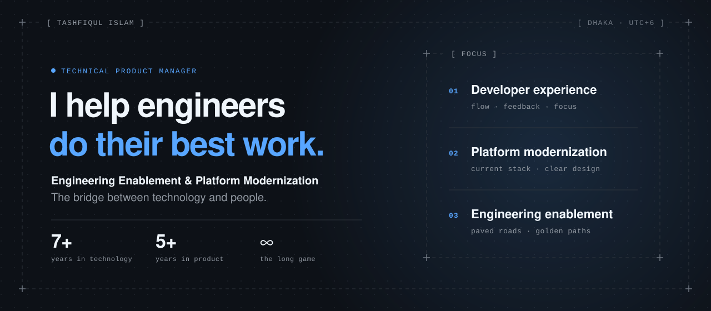
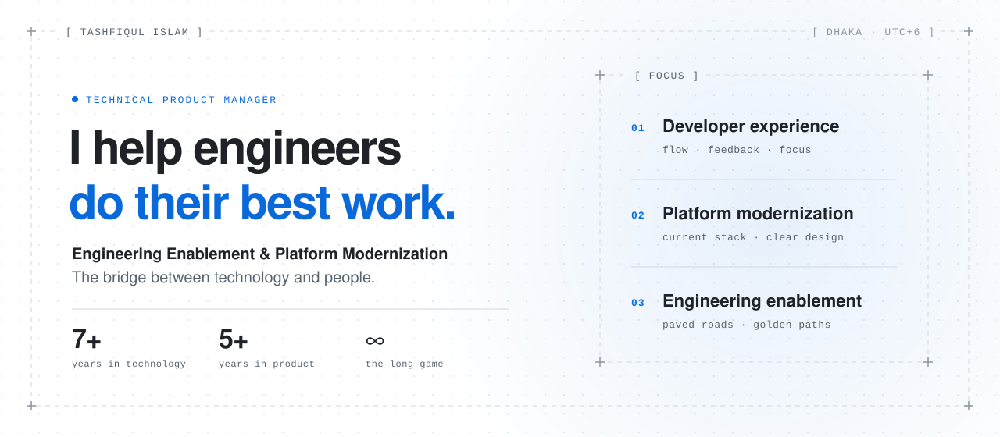
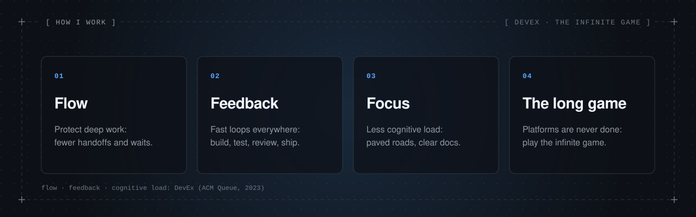
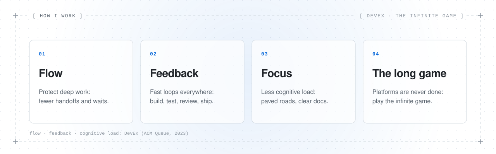
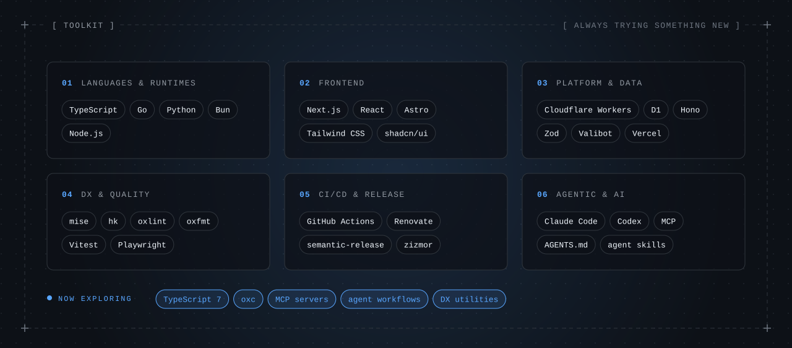
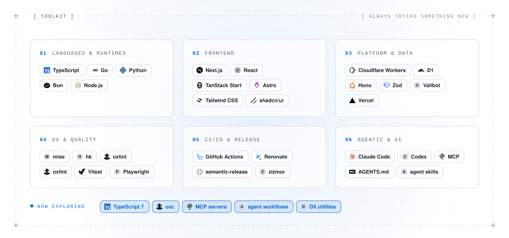
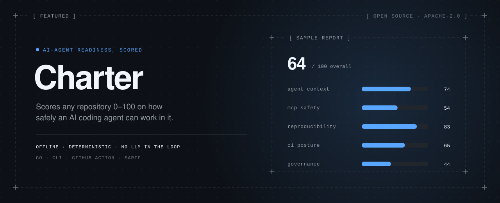
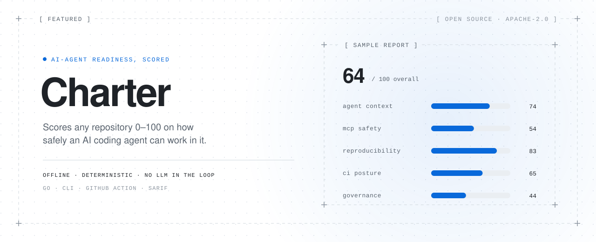
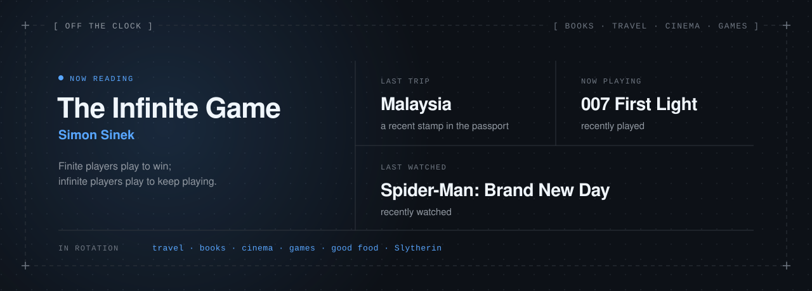
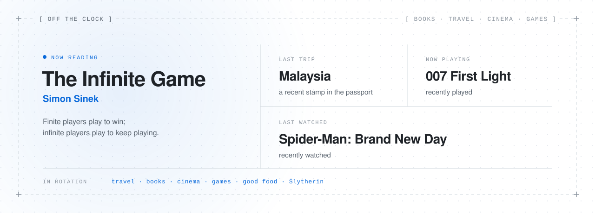

<h1 align="center">Hi 👋 — I’m Tashfiq.</h1>

<a href="https://github.com/tashfiqul-islam#gh-dark-mode-only">
  <picture>
    <source media="(max-width: 600px)" srcset="./assets/hero-mobile-dark.svg">
    
  </picture>
</a>
<a href="https://github.com/tashfiqul-islam#gh-light-mode-only">
  <picture>
    <source media="(max-width: 600px)" srcset="./assets/hero-mobile-light.svg">
    
  </picture>
</a>

<p align="center">
  <a href="https://www.linkedin.com/in/tashfiqulislam/" title="Connect on LinkedIn"></a>
  <a href="mailto:tashfiq61@gmail.com" title="Email Tashfiq"></a>
  <a href="https://www.instagram.com/_tashfiqulislam/" title="Instagram"></a>
  <a href="https://www.facebook.com/Tashfiq95" title="Facebook"></a>
  <a href="https://www.reddit.com/user/tashfiq61/" title="Reddit"></a>
</p>

<p align="center">
  <a href="https://github.com/tashfiqul-islam/profile-view-counter" title="Profile View Counter, built by me"></a>
</p>

<br>

## `01 / NOW`

I'm a **Technical Product Manager for Engineering Enablement & Platform Modernization** at
[Field Nation](https://github.com/fieldnation). My job is to help our engineers do their best work:
a developer experience that keeps them in flow, and a platform modernized with current technology
and clear design, so more of their time goes into work that matters to the business.

I'm the bridge between technology and people. Outside work I build open-source developer tools and
explore how teams can adopt AI coding agents safely.

`DEVELOPER EXPERIENCE` · `PLATFORM MODERNIZATION` · `ENGINEERING ENABLEMENT` · `AI AGENTS`

<br>

## `02 / HOW I WORK`

<a href="https://github.com/tashfiqul-islam#gh-dark-mode-only">
  <picture>
    <source media="(max-width: 600px)" srcset="./assets/principles-mobile-dark.svg">
    
  </picture>
</a>
<a href="https://github.com/tashfiqul-islam#gh-light-mode-only">
  <picture>
    <source media="(max-width: 600px)" srcset="./assets/principles-mobile-light.svg">
    
  </picture>
</a>

Every improvement runs the same loop, and it starts and ends with the engineers who use it:

```
+-------------- [ ENABLEMENT LOOP ] ---------------+
|                                                  |
| back: 5->1  every cycle starts with listening    |
|                                                  |
| 1  Listen                                        |
|    sit with teams, find where the day leaks      |
| │                                                |
| 2  Map the friction                              |
|    waits, handoffs, toil and unclear docs        |
| │                                                |
| 3  Pave the road                                 |
|    golden paths, modern tooling, sane defaults   |
| │                                                |
| 4  Ship it with engineers                        |
|    small releases, real adoption, fast feedback  |
| │                                                |
| 5  Measure                                       |
|    devex signals and delivery data               |
|                                                  |
+--------------------------------------------------+
```

<br>

## `03 / TOOLKIT`

<a href="https://github.com/tashfiqul-islam#gh-dark-mode-only">
  <picture>
    <source media="(max-width: 600px)" srcset="./assets/toolkit-mobile-dark.svg">
    
  </picture>
</a>
<a href="https://github.com/tashfiqul-islam#gh-light-mode-only">
  <picture>
    <source media="(max-width: 600px)" srcset="./assets/toolkit-mobile-light.svg">
    
  </picture>
</a>

What I reach for most, and I'm always trying something new: frameworks, workflows, agentic tools
and the small utilities that make a developer's day smoother.

<br>

## `04 / FEATURED OPEN SOURCE`

<a href="https://github.com/use-charter/charter#gh-dark-mode-only">
  <picture>
    <source media="(max-width: 600px)" srcset="./assets/charter-mobile-dark.svg">
    
  </picture>
</a>
<a href="https://github.com/use-charter/charter#gh-light-mode-only">
  <picture>
    <source media="(max-width: 600px)" srcset="./assets/charter-mobile-light.svg">
    
  </picture>
</a>

<p align="center">
  <strong><a href="https://github.com/use-charter/charter">Explore Charter →</a></strong>
  &nbsp;·&nbsp; <a href="https://use-charter.dev">Website</a>
  &nbsp;·&nbsp; <a href="https://github.com/marketplace/actions/charter-ai-agent-readiness">GitHub Marketplace</a>
  &nbsp;·&nbsp; <a href="https://use-charter.dev/rules">Rule catalog</a>
</p>

<br>

## `05 / SELECTED BUILDS`

| Project                                                                                       | What it does                                                                                                            | Built with             |
| --------------------------------------------------------------------------------------------- | ----------------------------------------------------------------------------------------------------------------------- | ---------------------- |
| [Profile View Counter](https://github.com/tashfiqul-islam/profile-view-counter)               | The visitor badge on this page: themed SVG badges, counted at the edge                                                  | Cloudflare Workers, D1 |
| [Profile Weather View](https://github.com/tashfiqul-islam/profile-weather-view)               | Writes live Dhaka weather into this README, no API key needed                                                           | Bun, GitHub Actions    |
| [Ghostframe](https://github.com/tashfiqul-islam/ghostframe)                                   | A grid look for the Claude Code transcript: gutter labels, rails and framed cards                                       | Claude Code            |
| [Dhaka Metro Station Finder](https://github.com/tashfiqul-islam/metro-station-finder)         | Finds the nearest metro station to any place in Dhaka ([live](https://tashfiqul-islam.github.io/metro-station-finder/)) | Next.js, maps          |
| [Bengali Text Summarizer](https://github.com/tashfiqul-islam/bengali-text-summarizer-website) | Summarizes Bengali news articles ([live](https://bengali-text-summarizer-website.vercel.app))                           | Next.js, NLP           |

<br>

## `06 / LIVE FROM DHAKA`

Current conditions, written into this README by [Profile Weather View](https://github.com/tashfiqul-islam/profile-weather-view).

<!-- Dhaka's weather table -->
<table align="center">
  <tr>
    <th>Weather</th>
    <th>Temperature</th>
    <th>Sunrise</th>
    <th>Sunset</th>
    <th>Humidity</th>
  </tr>
  <tr>
    <!-- Hourly Weather Update -->
        <td align="center">Light Drizzle </td>
        <td align="center">23°C</td>
        <td align="center">06:17</td>
        <td align="center">17:11</td>
        <td align="center">91%</td>
    <!-- End of Hourly Weather Update -->
  </tr>
</table>

<p align="center"><sub><em>Last refresh: Saturday, November 21, 2026 at 08:36:34 (UTC+6)</em></sub></p>
<!-- End of Dhaka's weather table -->

<br>

## `07 / OFF THE CLOCK`

<a href="https://github.com/tashfiqul-islam#gh-dark-mode-only">
  <picture>
    <source media="(max-width: 600px)" srcset="./assets/life-mobile-dark.svg">
    
  </picture>
</a>
<a href="https://github.com/tashfiqul-islam#gh-light-mode-only">
  <picture>
    <source media="(max-width: 600px)" srcset="./assets/life-mobile-light.svg">
    
  </picture>
</a>

<br>

---

<div align="center">
  <sub><strong>DEVELOPER EXPERIENCE · PLATFORM MODERNIZATION · OPEN SOURCE</strong></sub>
  <h3>Let's make engineering feel effortless.</h3>
  <p><strong><a href="mailto:tashfiq61@gmail.com">Email me →</a></strong> &nbsp;·&nbsp; <a href="https://www.linkedin.com/in/tashfiqulislam/">LinkedIn</a> &nbsp;·&nbsp; <a href="https://github.com/tashfiqul-islam?tab=repositories">All repositories</a></p>
</div>
